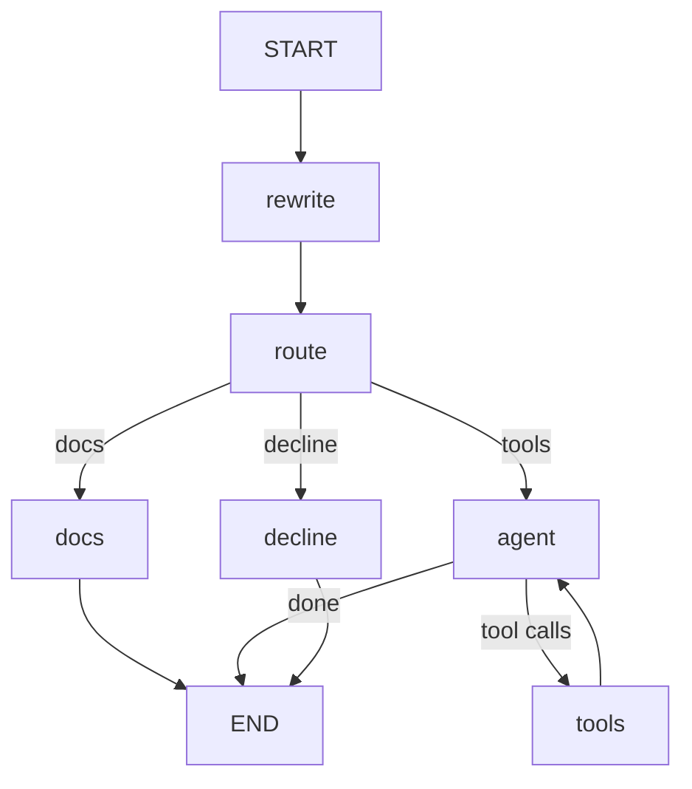

# <Your solution name>

One-line description: who it helps and what job it does.

**Live app:** https://your-app-name.streamlit.app
(Paste your own free Gemini key in the sidebar.)

## Architecture

(Replace with the output of the draw_mermaid command, and add any route you created.)

## Documents and sources
| File | Subject | Source / link |
|---|---|---|

## Tools
| Tool | What it does | Safe because |
|---|---|---|

## Extra feature
What it is and how it works.

## Limits
What it cannot do, and where it may be wrong.

## Run locally
    pip install -r requirements.txt
    streamlit run app.py

## Four questions (2 to 4 sentences each, in your own words)
1. Why did you choose these three routes?
2. What does the rewrite step do, and what breaks without it?
3. How does your solution stay safe?
4. What was your most important failure, and how did you fix it?
